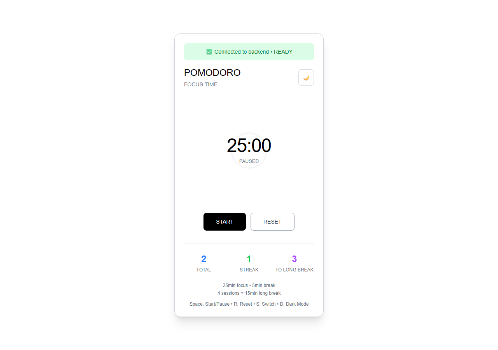
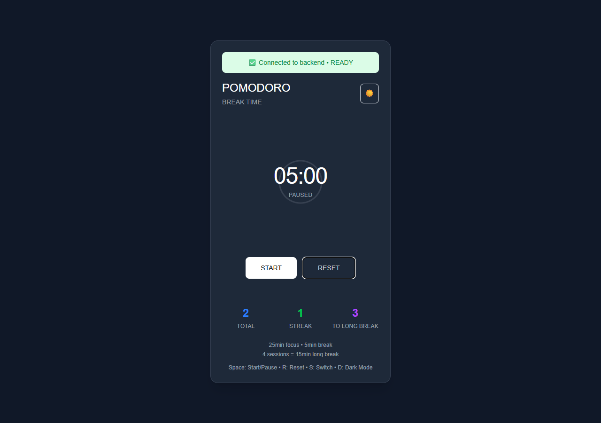

# Pomodoro Timer

An early React/Next.js focus-timer frontend driven by a separate HTTP API.
It displays focus/break time and session statistics, with start, pause, reset,
keyboard shortcuts and a saved light/dark preference.



**Status:** this public checkout is the older frontend at application revision
`e4e3105`. A related local repository has 13 later commits, including PWA and
public-profile work; those features and its separate Node backend are not
included or verified here. This README describes the source in this repository.

## Run and inspect

Verified with Node.js 24.11.1 and npm 11.6.2 on Windows; the lockfile pins Next.js
16.0.3 and React 19.2.0. Google font downloads require build-time network access.

```sh
git clone https://github.com/boyInShadows/PomodoroTimer.git
cd PomodoroTimer
npm ci
npm run dev
```

Open <http://localhost:3000>. Without the separate timer API, the page shows
**Connection Failed** and a retry action. Set the public `NEXT_PUBLIC_API_URL`
environment variable before running/building to the base address of a compatible
development API. An empty value uses same-origin `/api` paths; this frontend
does not implement the timer endpoints itself.

The [API client](lib/api/timer/timerClient.js) expects JSON from
`GET /api/health`, `/api/timer/state` and `/api/timer/stats`, plus
`POST /api/timer/start`, `/pause`, `/reset` and `/switch`. State contains
`isRunning`, `isFocus`, `timeLeft` in seconds and `totalSessions`; successful
actions return `{ success: true, state }`. Backend persistence is outside this
repository. Only the theme is saved locally by this timer view.

The [timer hook](hooks/useTimer.js) polls every second while running and every
three seconds while paused. Space starts/pauses, R resets, S switches mode and
D changes theme. Login/register screens are experimental; their authentication
and browser token storage require review before production use.



## Verification

```sh
npm run lint
npm run build
npm start
```

On 2026-10-30, locked installation, lint and production build passed. Lint has
one existing unused-disable warning; build reports old browser-baseline data.
Edge checks verified connection failure/retry and start/pause/reset/switch
requests with intercepted synthetic responses, plus theme switching. The
captures show the actual frontend with that fixture, not a live backend or
proof of real elapsed-time accuracy, notifications or durable session storage.

There is no frontend test script or hosted quality CI. Real backend/auth,
background timing, physical-device behavior and full accessibility remain
unverified. A dated npm audit found 16 advisories (1 critical, 11 high,
3 moderate, 1 low); no dependency upgrade was performed. Existing contribution
history and rights remain unchanged; no license is assigned by this update.
